<!-- Generated by pulse (see pulse/ and profile.yml); refreshed by .github/workflows/refresh.yml -->

<!-- pulse:hero -->
<p align="center">
<picture><source media="(prefers-color-scheme: dark)" srcset="assets/status-dark.svg"></picture>
</p>

<p align="center">
<b>Data Scientist</b> at <a href="https://sandatasystem.ai/"><b>SAN Data Systems</b></a><br>
building <a href="https://niriksha.ai/"><b>NirikshaAI</b></a> — AI-native observability for LLMs, agents, RAG and Kubernetes
</p>

<p align="center">
<picture><source media="(prefers-color-scheme: dark)" srcset="assets/activity-dark.svg"></picture>
</p>
<!-- /pulse:hero -->

<!-- pulse:manifest -->
```yaml
apiVersion: human.dev/v1
kind: DataScientist
metadata:
  name: vivek.bhadauriya
  labels:
    role: data-scientist
    region: us-west (Fremont, CA)
spec:
  displayName: Vivek Singh Bhadauriya
  employer: SAN Data Systems  # https://sandatasystem.ai/
  building:
    - NirikshaAI: AI-native observability for LLMs, agents, RAG and Kubernetes
  focus:
    - Machine learning & LLM systems (agents, RAG, evaluation)
    - MLOps on Kubernetes with Kubeflow Pipelines, MLflow, KServe and Seldon
    - LLM serving and inference with vLLM, TGI and Ollama
    - LLM observability & AI security (prompt-injection, PII) at NirikshaAI
    - OpenTelemetry SDKs & tracing (Go, Python, Node, Java)
  stack:
    languagesAPIs: [Python, Go, TypeScript, Java, FastAPI]
    mlFrameworks: [PyTorch, TensorFlow, Keras, scikit-learn, XGBoost, Hugging Face Transformers]
    mlops: [Kubeflow, MLflow, KServe, Seldon, Ray, Airflow, Feast, DVC]
    llmGenAI: [LangChain, LlamaIndex, vLLM, TGI, Ollama, RAG, Vector DBs, OpenAI API, Anthropic API, AWS Bedrock]
    cloudPlatform: [Kubernetes, Helm, Docker, Argo CD, GitOps, Terraform, AWS, GCP, Azure]
    observability: [OpenTelemetry, Prometheus, Grafana]
status:
  phase: Running  # since 2018-10-18
  observedLanguages: [Go, TypeScript, JavaScript, Shell]  # live, recency-weighted
  recentlyShipped: [niriksha-sdk-node, niriksha-sdk-go, niriksha-sdk-java, niriksha-sdk-python]  # public, last 30d
```
<!-- /pulse:manifest -->

<!-- pulse:panels -->
<p align="center">
<picture><source media="(prefers-color-scheme: dark)" srcset="assets/toolchain-dark.svg"></picture>
</p>

<p align="center">
<picture><source media="(prefers-color-scheme: dark)" srcset="assets/servicemap-dark.svg"></picture>
</p>

<p align="center">
<picture><source media="(prefers-color-scheme: dark)" srcset="assets/deploylog-dark.svg"></picture>
</p>

<p align="center">
<picture><source media="(prefers-color-scheme: dark)" srcset="assets/slo-dark.svg"></picture>
</p>

<p align="center">
<picture><source media="(prefers-color-scheme: dark)" srcset="assets/alerts-dark.svg"></picture>
</p>

<p align="center">
<picture><source media="(prefers-color-scheme: dark)" srcset="assets/reviews-dark.svg"></picture>
</p>

<p align="center">
<picture><source media="(prefers-color-scheme: dark)" srcset="assets/timeseries-dark.svg"></picture>
</p>

<p align="center">
<picture><source media="(prefers-color-scheme: dark)" srcset="assets/churn-dark.svg"></picture>
</p>

<p align="center">
<picture><source media="(prefers-color-scheme: dark)" srcset="assets/heatmap-dark.svg"></picture>
</p>

<p align="center">
<picture><source media="(prefers-color-scheme: dark)" srcset="assets/trace-dark.svg"></picture>
</p>

<p align="center">
<picture><source media="(prefers-color-scheme: dark)" srcset="assets/drift-dark.svg"></picture>
</p>

<p align="center">
<picture><source media="(prefers-color-scheme: dark)" srcset="assets/resources-dark.svg"></picture>
</p>

<p align="center">
<picture><source media="(prefers-color-scheme: dark)" srcset="assets/records-dark.svg"></picture>
</p>

<p align="center">
<picture><source media="(prefers-color-scheme: dark)" srcset="assets/featured-dark.svg"></picture>
</p>

<p align="center"><a href="https://github.com/san-data-systems/niriksha-sdk-go"><code>niriksha-sdk-go</code></a> · <a href="https://github.com/san-data-systems/niriksha-sdk-node"><code>niriksha-sdk-node</code></a> · <a href="https://github.com/san-data-systems/niriksha-sdk-python"><code>niriksha-sdk-python</code></a> · <a href="https://github.com/san-data-systems/niriksha-sdk-java"><code>niriksha-sdk-java</code></a></p>

<p align="center">
<picture><source media="(prefers-color-scheme: dark)" srcset="assets/pods-dark.svg"></picture>
</p>
<!-- /pulse:panels -->

<!-- pulse:writing -->

<!-- /pulse:writing -->

<p align="center">
<!-- pulse:links -->
[`niriksha.ai`](https://niriksha.ai/) · [`sandatasystem.ai`](https://sandatasystem.ai/) · [`github`](https://github.com/V-Bhadauriya)
<!-- /pulse:links -->
</p>

<p align="center">
<!-- pulse:footer -->
<sub>last scrape <code>2026-10-22 UTC</code> · refreshed every 6h by a GitHub Action · rendered by <a href="pulse"><code>pulse</code></a> — no third-party widgets</sub>
<!-- /pulse:footer -->
</p>
